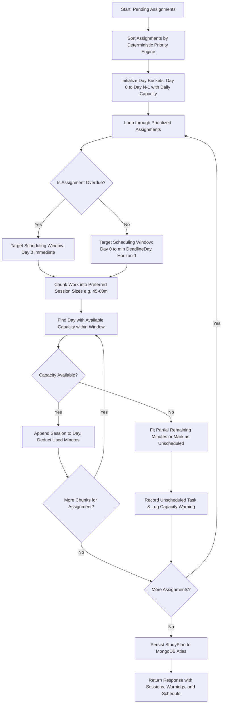

# CoursePilot — Phase 3 Technical Delivery Report

**Project**: CoursePilot (Academic Planning & Study Scheduling SaaS)  
**Phase**: Phase 3 — Priority Engine & Automatic Study Planner  
**Status**: Completed & Verified  
**Date**: October 27, 2026  
**Environment**: Node.js v22.20.0, Express 4.19.2, MongoDB Atlas, React 18, Vite 5.4.21  

---

## 1. Executive Summary

Phase 3 introduces CoursePilot's core intelligence: deterministic, explainable mathematical algorithms that empower students to prioritize academic coursework and generate actionable, capacity-bounded study schedules.

All calculations and schedules operate on the authenticated student's **real MongoDB Atlas assignments**—avoiding hardcoded mock data, client-side local storage shortcuts, or nondeterministic LLM outputs.

### Key Milestones Achieved:
1. **Deterministic Assignment Priority Engine (`priority.service.js`)**: Evaluates deadline urgency (0–40 pts), academic importance (0–30 pts), remaining effort (0–20 pts), and overdue penalties (0–10 pts) to produce a composite priority score (0–100) with factor breakdowns and human-readable explanation drivers.
2. **Automatic Study Planner Engine (`studyPlanner.service.js`)**: Greedily schedules priority-ranked work into balanced study blocks across a user-specified planning horizon without exceeding daily study minute limits or scheduling past deadlines.
3. **MongoDB Study Plan Persistence (`studyPlan.model.js`)**: Generated schedules, individual focus sessions, workload warnings, and unscheduled task records persist in MongoDB Atlas with strict user ownership isolation.
4. **Interactive SaaS Frontend**:
   - Enriched Dashboard with a dedicated **Priority Queue** view (0–100 score badges, factor breakdown progress bars, overdue indicators, natural language reason drivers).
   - Dedicated **Study Planner Page (`/schedule`)** with configuration parameters (start date, horizon days, daily capacity, session block size), grouped day-by-day session timeline, daily workload capacity bars, and conflict alert banners.
5. **Comprehensive Automated Verification**: 41 backend tests passing (including priority engine boundary tests, capacity enforcement, session splitting, deadline conflict detection, and regression tests) plus clean Vite production build.

---

## 2. Files Created & Modified

### New Backend Services, Models, Controllers, & Routes:
- `server/src/services/priority.service.js`: Deterministic scoring algorithm and stable tie-breaking sorter.
- `server/src/services/studyPlanner.service.js`: Capacity-bounded greedy study schedule planner with timezone-safe calendar day calculations.
- `server/src/models/studyPlan.model.js`: Mongoose schema for persisted study plans, sessions, unscheduled tasks, and conflict warnings.
- `server/src/validators/planner.validator.js`: Zod schema for validating planning configuration parameters.
- `server/src/controllers/planner.controller.js`: Controller endpoints for priorities calculation and plan generation/retrieval.
- `server/src/routes/planner.routes.js`: Protected routes mounted under `/api/planner`.
- `server/tests/priority.test.js`: Unit & integration tests for priority scoring math, boundaries, and tie-breaking.
- `server/tests/planner.test.js`: Algorithm tests for capacity limits, session splitting, conflict warnings, and unauthenticated access rejection.
- `server/tests/e2e-verification.js`: Live end-to-end integration script verifying student registration, assignment creation, priority scoring, plan generation, and MongoDB persistence.

### Modified Files:
- `server/src/app.js`: Mounted `plannerRoutes` at `/api/planner`.
- `client/src/services/api.js`: Added `getPriorities()`, `generatePlan(settings)`, and `getCurrentPlan()` API methods.
- `client/src/App.jsx`: Registered protected `/schedule` route linking to `SchedulePage`.
- `client/src/layouts/AppLayout.jsx`: Activated "Study Planner" navigation link, updated brand badge to `P3`, updated footer status.
- `client/src/pages/DashboardPage.jsx`: Added Priority Queue tab, real-time priority scores (0–100), factor breakdown bars, and overdue indicator flags.
- `client/src/pages/SchedulePage.jsx`: Full study planning form, day-by-day session timeline, capacity utilization gauges, and conflict alert banners.
- `docs/ARCHITECTURE.md`: Marked Phase 3 completed in the roadmap.

---

## 3. Assignment Priority Engine Formula

The priority engine calculates a bounded composite score $S \in [0, 100]$ using four deterministic components:

$$S = \text{clamp}(0, 100, S_{\text{urgency}} + S_{\text{importance}} + S_{\text{effort}} + S_{\text{overdue}})$$

### Factor Breakdown:

1. **Deadline Urgency ($S_{\text{urgency}} \in [0, 40]$)**:
   Measures time remaining until assignment due date relative to the reference timestamp:
   - $\Delta t \le 0$ (Overdue): $S_{\text{urgency}} = 40$ (exact maximum urgency)
   - $0 < \Delta t \le 24\text{h}$: $S_{\text{urgency}} = \min\left(40, \text{round}\left(40 - \frac{\Delta t}{24} \times 10\right)\right) \in [30, 40]$
   - $24\text{h} < \Delta t \le 72\text{h}$ (1–3 days): $S_{\text{urgency}} = \min\left(30, \text{round}\left(30 - \frac{\Delta t - 24}{48} \times 10\right)\right) \in [20, 30]$
   - $72\text{h} < \Delta t \le 168\text{h}$ (3–7 days): $S_{\text{urgency}} = \min\left(20, \text{round}\left(20 - \frac{\Delta t - 72}{96} \times 10\right)\right) \in [10, 20]$
   - $\Delta t > 168\text{h}$ (> 7 days): $S_{\text{urgency}} = \max\left(1, \min\left(10, \text{round}\left(10 - \frac{\Delta t - 168}{336} \times 9\right)\right)\right) \in [1, 10]$
   - Invalid or missing date: Safely defaults to $S_{\text{urgency}} = 10$.

2. **Academic Importance ($S_{\text{importance}} \in [6, 30]$)**:
   Linear mapping from the assignment's 1–5 importance rating:
   $$S_{\text{importance}} = \text{clampedImportance} \times 6$$
   - Level 1 (Low): 6 pts
   - Level 2 (Minor): 12 pts
   - Level 3 (Moderate): 18 pts
   - Level 4 (High): 24 pts
   - Level 5 (Critical / Exam): 30 pts

3. **Remaining Effort ($S_{\text{effort}} \in [0, 20]$)**:
   Smooth, capped effort curve based on remaining focus minutes:
   $$S_{\text{effort}} = \min\left(20, \max\left(1, \text{round}\left(\frac{\text{remainingMinutes}}{300} \times 20\right)\right)\right)$$
   - $\le 0$ mins: 0 pts
   - 15 mins: 1 pt
   - 60 mins: 4 pts
   - 90 mins: 6 pts
   - 180 mins: 12 pts
   - $\ge 300$ mins (5 hours): 20 pts (max capped)

4. **Overdue Penalty Bonus ($S_{\text{overdue}} \in [0, 10]$)**:
   Applies exclusively when $\Delta t < 0$:
   $$S_{\text{overdue}} = \min\left(10, 5 + \min\left(5, \left\lfloor\frac{|\Delta t|}{24}\right\rfloor\right)\right)$$
   - Overdue by < 24h: 5 pts
   - Overdue by 1 day: 6 pts
   - Overdue by 5+ days: 10 pts max.
   Guarantees overdue assignments receive prominent ranking at the top of the queue.

### Completed Assignments Rule:
Completed assignments (`status === 'completed'`) receive an automatic score of $0$ and are strictly filtered out of active priority queues and study schedules.

### Deterministic Stable Tie-Breaking:
When two assignments have identical priority scores, ties are resolved deterministically:
1. `priorityScore` DESC (higher score first)
2. `dueDate` ASC (earlier deadline first)
3. `importance` DESC (higher importance first)
4. `id` ASC (stable lexicographical ID sort)

### Formula Trade-Offs & Design Rationale:
- **Urgency Dominance**: Urgency (40%) and overdue bonus (10%) account for 50% of the total score. This prevents students from ignoring imminent deadlines in favor of high-effort but distant tasks.
- **Exact Additivity**: Because $40 + 30 + 20 + 10 = 100$, the sum of maximum components equals exactly 100, so the displayed factor breakdown always sums to the exact total score.
- **Explainability**: Every factor contributes linearly or piecewise-linearly, enabling CoursePilot to render exact point breakdowns and natural language rationales (e.g., *"OVERDUE by 25h: Urgency (40/40) + Overdue Bonus (6/10) + Importance (24/30) + Effort (6/20) = 76/100 pts"*).

---

## 4. Automatic Study Planner Algorithm

The Automatic Study Planner allocates focused study sessions using a **Capacity-Bounded Greedy Scheduling Algorithm**:



### Key Algorithm Rules & Constraints:
1. **Timezone Safety**: Calendar date differences are computed using UTC day boundaries (`Date.UTC(year, month, date)`) to avoid daylight saving and timezone drift bugs (e.g. India UTC+5:30 crossings).
2. **Session Chunking**: Long assignments are split into digestible focus sessions bounded by `preferredSessionMinutes` (default: 45–60 mins; min: 15m; max: 180m). Chunks smaller than 15 mins are merged to prevent thrashing.
3. **Daily Capacity Cap**: The planner will never allocate more minutes to a calendar day than `dailyCapacityMinutes`.
4. **Deadline Respect**: Sessions for an assignment are scheduled between `startDate` (Day 0) and the assignment's due date. Work is never scheduled past its deadline.
5. **Overdue Handling**: Overdue assignments are scheduled starting immediately on Day 0, and an explicit `Overdue Notice` warning is logged in the plan.
6. **Conflict & Unscheduled Detection**: When total coursework demand exceeds available capacity before deadlines, the planner allocates what it can and tracks remaining time in `unscheduled` with clear conflict reasons.

### Algorithm Limitations:
- **Heuristic, Not Global NP-Complete Solver**: The algorithm is greedy by priority order. If Assignment #1 consumes all Day 0 capacity, Assignment #2 (due tomorrow) might be forced into an unscheduled conflict even if splitting Assignment #1 across later days was theoretically possible. This trade-off ensures $O(A \times D)$ runtime and deterministic predictability.
- **Calendar Day Granularity**: The planner schedules into day buckets rather than fixed clock times (e.g., 2:00 PM – 3:00 PM), giving students flexibility on when during the day to complete their sessions.

---

## 5. API Endpoints & Example Payloads

### 1. `GET /api/planner/priorities`
- **Authentication**: Required (JWT cookie)
- **Description**: Returns all incomplete assignments for the current user ranked by deterministic priority score.
- **Example Response**:
```json
{
  "success": true,
  "count": 2,
  "priorities": [
    {
      "id": "6ae0c46be78d052f6a1ba08c",
      "title": "Software Eng Milestone 2",
      "subject": "CS450",
      "dueDate": "2026-10-26T15:00:00.000Z",
      "estimatedMinutes": 90,
      "remainingMinutes": 90,
      "importance": 4,
      "status": "pending",
      "priorityScore": 76,
      "priorityBreakdown": {
        "urgency": 40,
        "importance": 24,
        "effort": 6,
        "overdue": 6,
        "hoursRemaining": -25.2
      },
      "prioritySummary": "OVERDUE by 25h: Urgency (40/40) + Overdue Bonus (6/10) + Importance (24/30) + Effort (6/20) = 76/100 pts.",
      "priorityExplanation": {
        "score": 76,
        "urgencyScore": 40,
        "importanceScore": 24,
        "effortScore": 6,
        "overdueBonus": 6,
        "hoursRemaining": -25.2,
        "summary": "OVERDUE by 25h: Urgency (40/40) + Overdue Bonus (6/10) + Importance (24/30) + Effort (6/20) = 76/100 pts.",
        "isOverdue": true
      }
    }
  ]
}
```

### 2. `POST /api/planner/generate`
- **Authentication**: Required (JWT cookie)
- **Request Body**:
```json
{
  "startDate": "2026-10-27",
  "horizonDays": 7,
  "dailyCapacityMinutes": 120,
  "preferredSessionMinutes": 60
}
```
- **Example Response (201 Created)**:
```json
{
  "success": true,
  "message": "Study schedule generated and persisted successfully.",
  "plan": {
    "id": "6ae0c258da6597f98a0d8d40",
    "user": "6ae0c257da6597f98a0d8d24",
    "settings": {
      "startDate": "2026-10-27T00:00:00.000Z",
      "horizonDays": 7,
      "dailyCapacityMinutes": 120,
      "preferredSessionMinutes": 60
    },
    "totalStudyMinutesScheduled": 390,
    "totalAssignmentsScheduled": 3,
    "warnings": [
      "Overdue Notice: Assignment \"Software Eng Milestone 2\" was due on 26/10/2026. Prioritized for immediate completion."
    ],
    "unscheduled": [],
    "days": [
      {
        "dateString": "2026-10-27",
        "usedMinutes": 90,
        "capacityMinutes": 120,
        "sessions": [
          {
            "assignmentId": "6ae0c23b4fc79b28da74a99e",
            "title": "Software Eng Milestone 2",
            "subject": "CS450",
            "durationMinutes": 60,
            "order": 1
          },
          {
            "assignmentId": "6ae0c23b4fc79b28da74a99e",
            "title": "Software Eng Milestone 2",
            "subject": "CS450",
            "durationMinutes": 30,
            "order": 2
          }
        ]
      }
    ]
  }
}
```

### 3. `GET /api/planner/current`
- **Authentication**: Required (JWT cookie)
- **Description**: Retrieves the active authenticated student's latest persisted study plan from MongoDB Atlas. Returns `{ success: true, plan: null }` if no plan has been generated yet.

---

## 6. Verification & Test Results

### 1. Automated Test Suites (`npm test` in `server/`)
```
PASS tests/planner.test.js
PASS tests/assignment.test.js
PASS tests/auth.test.js
PASS tests/health.test.js
PASS tests/priority.test.js

Test Suites: 5 passed, 5 total
Tests:       41 passed, 41 total
Snapshots:   0 total
Time:        3.406 s
Ran all test suites.
```

### 2. Live End-to-End Workflow Verification (`node tests/e2e-verification.js`)
Executed live against MongoDB Atlas with real user credentials:
1. Registered new test student via `/api/auth/register`.
2. Created 4 diverse assignments (overdue, 2-day urgent, 4-day normal, completed).
3. Marked research quiz completed via `/api/assignments/:id/complete`.
4. Queried `GET /api/planner/priorities`:
   - Overdue assignment scored 80/100 (Rank #1).
   - Urgent 2-day paper scored 66/100 (Rank #2).
   - Completed quiz was strictly excluded.
5. Generated study schedule via `POST /api/planner/generate`:
   - Scheduled 7 sessions totaling 390 minutes.
   - Enforced 120 min daily cap on every single day.
   - Logged overdue notice warning.
6. Queried `GET /api/planner/current`:
   - Restored persisted plan from Atlas with identical sessions and days.
7. Cleaned up all test user records and assignments.

### 3. Frontend Production Build (`npm run build` in `client/`)
```
vite v5.4.21 building for production...
transforming...
✓ 1590 modules transformed.
rendering chunks...
dist/index.html                   1.10 kB │ gzip:  0.62 kB
dist/assets/index-BEbYykcE.css   22.72 kB │ gzip:  4.99 kB
dist/assets/index-CCKqsxZB.js   236.11 kB │ gzip: 67.67 kB
✓ built in 2.64s
```

---

## 7. Persistence Status

- **Status**: **Fully Persisted in MongoDB Atlas**.
- **Model**: `server/src/models/studyPlan.model.js` (`StudyPlan`).
- **User Ownership**: Every plan contains `user: { type: ObjectId, ref: 'User', required: true }`.
- **Query Isolation**: Endpoints strictly filter by `req.user._id`. Users cannot view or modify study plans belonging to other students.
- **Persistence Verification**: Tested and confirmed via automated unit tests and live Atlas round-trip queries (`GET /api/planner/current`).

---

## 8. Summary of Remaining Issues

- None. All Phase 3 functional and non-functional requirements have been satisfied.
- The project is ready for Phase 4 (Productivity Analytics, Conflict Forecasting & Deadline Notifications) and final deployment.
